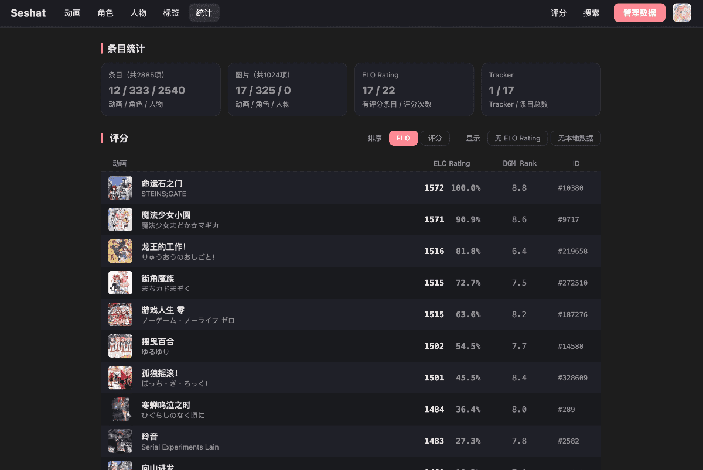

# Seshat

离线优先的 Bangumi 数据管理与浏览工具。所有数据存放在本地。  
特别感谢 [番组计划](https://bgm.tv/) 的数据源。

## 主要功能

- 双链和多维度检索
- 离线优先，数据保存在本地，仅拉取时联网
- ELO 评分排名
- 同步你“番组计划”的数据

前后端分离，Seshat 获取数据的 API 设计，与“番组计划”API 完全一致。
因此还可以直接使用 Seshat 前端，访问“番组计划”的内容。  
并支持在本地数据不足时，自动回退以从远端拉取数据。

## 使用

首次使用，请阅读[快速指南](/docs/guide.md)。  
详细功能，请参考[浏览与评分](/docs/usage.md)、[管理数据](/docs/manage.md)、[配置](/docs/config.md)。

从 1.x 升级，请阅读 [迁移说明](/MIGRATION.md)。

Seshat 提供 Desktop 和 Server 两种运行方式。  
二者功能和行为完全一样。Desktop 版本可以作为桌面应用，Server 使用浏览器展示前端。

### Seshat Desktop

只需要下载对应平台的安装包，安装后即可运行。

对于 macOS，打开程序时可能会提示“未打开，无法验证...”，这是因为我没钱买一年 99 美元的苹果证书。  
安装好后，请打开终端，输入 `xattr -cr ` 后，将 Seshat 程序拖入终端窗口，然后点击回车即可。

对于 Windows，首次打开安装程序或 Server 程序时会弹出 Defender 蓝窗口，这是因为我也没钱买微软的证书...  
只需要点击“更多信息”，然后点击“仍要运行”即可。

Linux 请使用 Server~~，因为我懒了QvQ，对不起呜呜。~~

### Seshat Server

对于 macOS 和 Linux，运行之前需要执行 `chmod +x`，然后通过 `./seshat-server-xxx` 运行。  
Windows 双击运行即可。

运行时，请保持终端窗口打开。程序启动后，会自动拉起浏览器。  
如果浏览器没有自动打开，请访问 `http://127.0.0.1:12500`（或配置中的地址和端口）。

## 贡献

见 [CONTRIBUTING.md](/CONTRIBUTING.md)。
