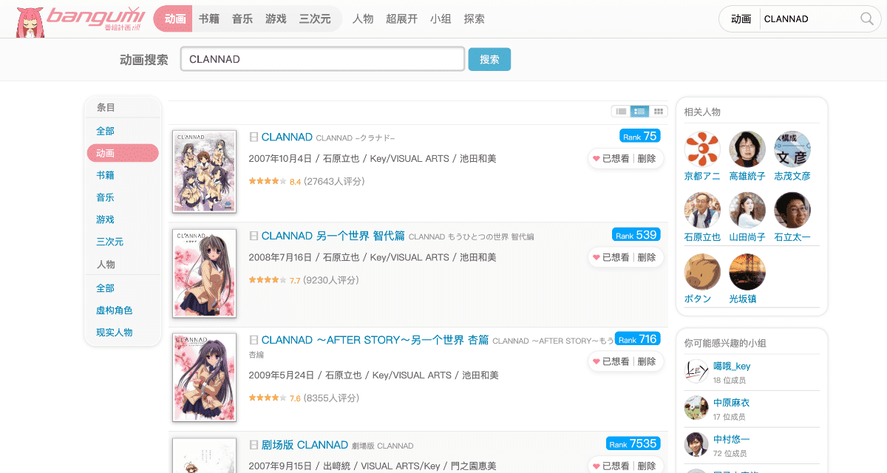
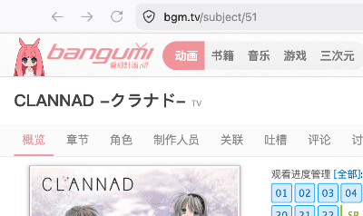

# 快速指南

如果你是一般用户，请阅读本文和[浏览与评分](usage.md)、[管理数据](manage.md)。  
不需要修改配置文件，因为已经预设了可用且功能完善的配置。

对于高级用户，请额外阅读[配置](config.md)。  
对于希望将 Seshat 集成到其他软件的开发者，请额外阅读[API 设计说明](api/design.md)、[OpenAPI 文档](api/openapi.yaml)。

## 启动

程序启动后，访问 `http://127.0.0.1:12500/` 打开 WebUI。Desktop 版直接启动程序即可。  
首次运行，你会看到空白的页面，这是因为还没有拉取数据。

### 网络

如果你的网络无法直接访问“番组计划”，可以为后端配置代理。  
很遗憾的，“番组计划”目前被 GFW 屏蔽。如果你身处中国大陆，则大概率无法直接访问...

如果你的代理工具支持 TUN 模式，启动它，将无须单独为 Seshat 配置代理。  
（视工具不同，此模式可能叫作：虚拟网卡模式、增强模式、接管所有流量、透明代理等）

代理配置见[配置](config.md#proxy代理)。

## 获取动画 ID

要拉取数据，你需要先知道动画对应的 `ID`，这是“番组计划”中为每个项目分配的唯一 ID，在 Seshat 中也使用它来识别动画。

你可以直接在“管理数据”页面的“上游 ID 搜索”中搜索动画名称，然后点击结果右侧的加号。

也可以访问[番组计划](https://bgm.tv/)，进入动画详情页，查看浏览器地址栏。  
下面以《CLANNAD》为例，地址栏中的 `51` 就是这部动画的 ID。

## 首次拉取数据

进入“管理数据”页面，来源保持“指定 ID”，在输入框中填写 `51`。  
其他选框保持默认，然后点击“开始拉取”，在确认弹窗中执行。

程序会拉取这部动画的：

- 动画详情，以及动画海报
- 剧集列表
- 出演角色、制作人员列表，以及他们的图片、详情

右下角会显示拉取进度。根据网络环境，需要几秒到一分钟左右。  
拉取成功后，回到首页就能看到这部动画的海报了。

之后想继续添加动画、维护 Tracker 或批量刷新，请参考[管理数据](manage.md)。  
若要了解详情页、搜索、评分和统计，请参考[浏览与评分](usage.md)。
